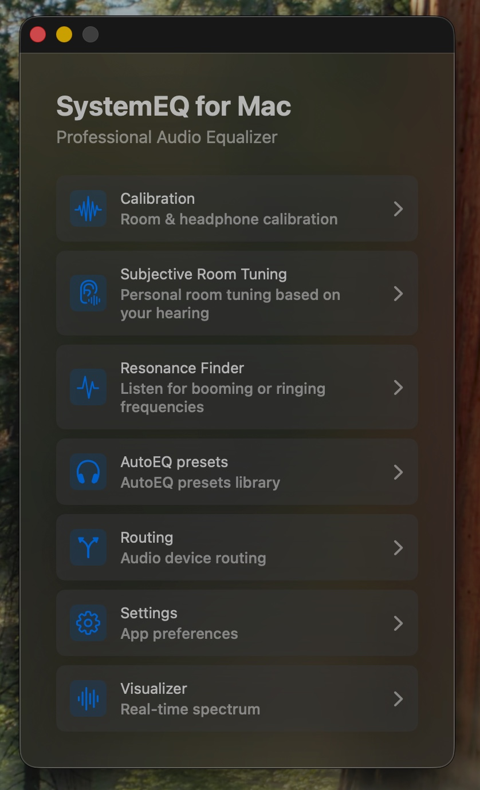
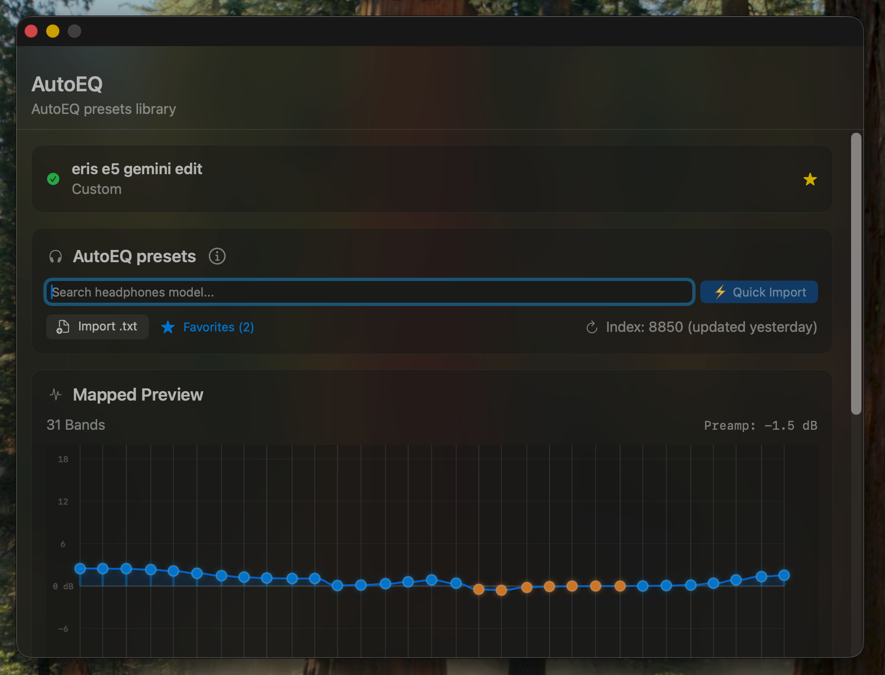
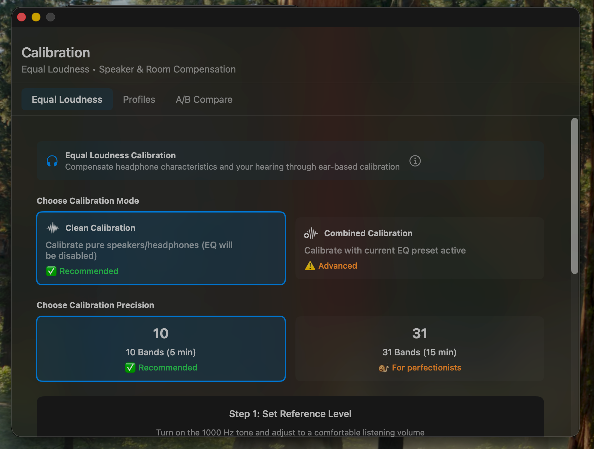
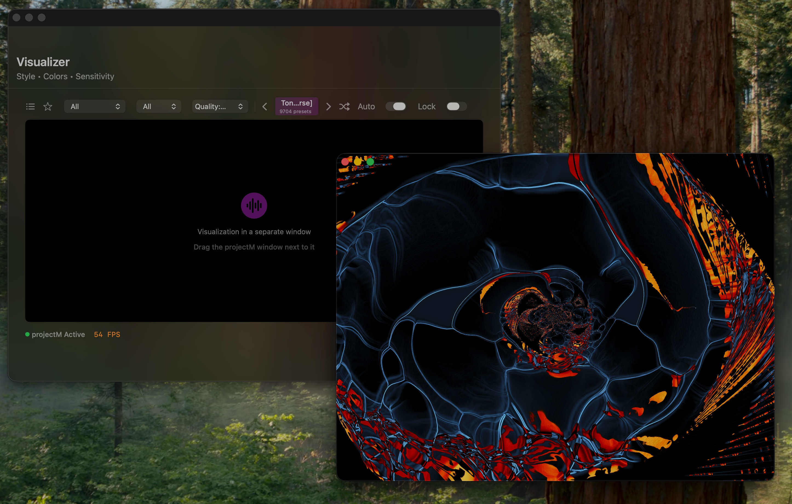
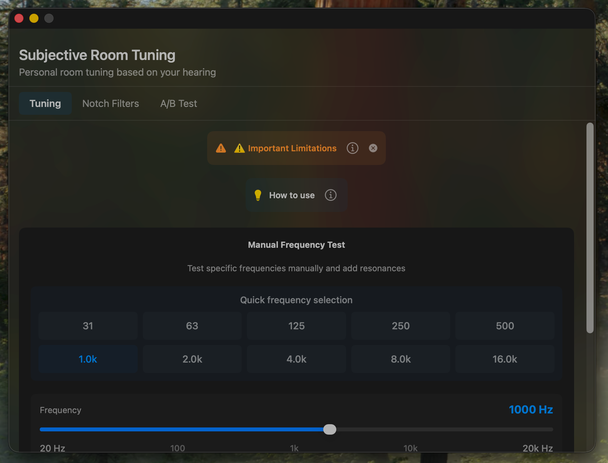
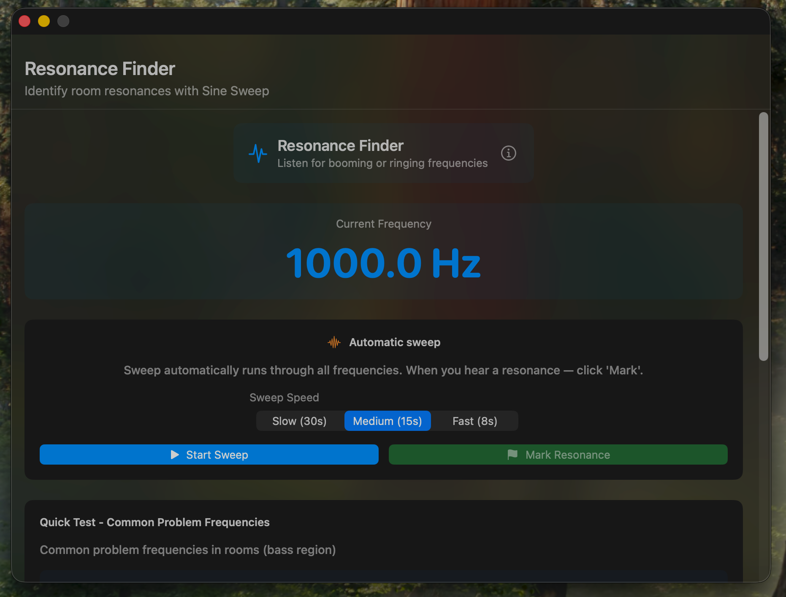
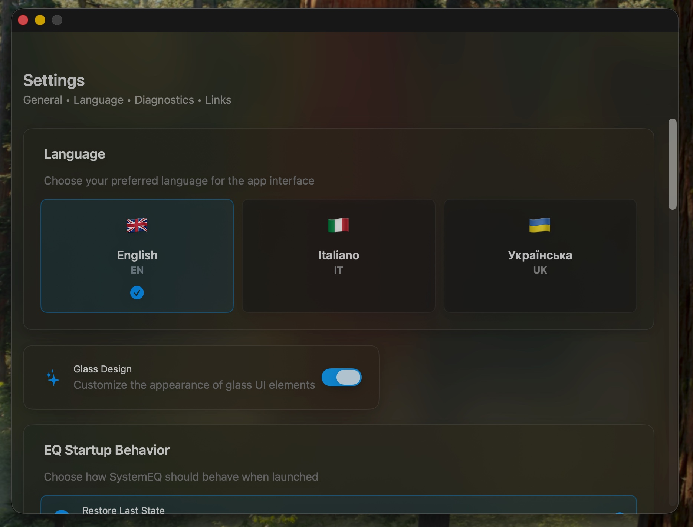

# SystemEQ for Mac

Equalizzatore parametrico gratuito e open source a livello di sistema per macOS 13+

Regola ogni suono del Mac — Spotify, YouTube, Apple Music e altro.
EQ a 10/31 bande, database AutoEQ per 8.666 modelli di cuffie, calibrazione
dell'udito, strumenti per l'ambiente e visualizzatore in tempo reale. Nessun abbonamento o telemetria.

[](https://www.apple.com/macos/)
[](https://swift.org)
[](LICENSE)
[](https://github.com/denzam/SystemEQ-for-Mac/releases/latest)
[](https://denzam.github.io/SystemEQ-for-Mac/)
[](https://github.com/denzam/SystemEQ-for-Mac/releases)

> 🇮🇹 Italiano | 🇬🇧 [English](README.md) | 🇺🇦 [Українська](README.ua.md)
>
> **[Vai direttamente all’installazione](#installazione)**



## 📸 Schermate

| Menu principale | Database AutoEQ | Calibrazione | Visualizzatore |
| :---: | :---: | :---: | :---: |
| [](Docs/screenshots/01-main.jpeg) | [](Docs/screenshots/07-autoeq-library.png) | [](Docs/screenshots/02-calibration-mode.png) | [](Docs/screenshots/15-visualizer-active.jpeg) |

| Regolazione Soggettiva Stanza | Trova Risonanze | Preset per uscita |
| :---: | :---: | :---: |
| [](Docs/screenshots/04-room-tuning.png) | [](Docs/screenshots/05-resonance-sweep.png) | [](Docs/screenshots/10-settings-language.jpeg) |

## ✨ Funzionalità

### Funzioni principali

- **EQ Parametrico 10/31 bande** — Elaborazione audio professionale con filtri biquad
- **Database AutoEQ** — 8.666 modelli di cuffie, 8.851 preset (SQLite, 18 MiB)
- **Visualizzazione in tempo reale** — Spettro, Forma d'onda, Particelle, Psichedelico
- **Modulo di calibrazione** — Test dell'udito + profili personalizzati + confronto A/B
- **Regolazione Soggettiva Stanza** — Regola la risposta della stanza a orecchio
- **Trova Risonanze** — Sweep sinusoidale per trovare frequenze rimbombanti o squillanti
- **Cattura audio di sistema nativa** — Process Tap su macOS 14.4+; BlackHole resta il fallback automatico
- **Gestione preset** — Salva, carica e organizza le impostazioni EQ
- **Cambio preset automatico per uscita** — Facoltativamente riapplica il preset salvato quando cambi uscita fisica
- **Avvia al login** — Login Item opzionale di macOS
- **Nascondi icona dal Dock** — Mantiene il controllo nella barra dei menu
- **Multilingua** — Inglese, Italiano, Ucraino

### Motore audio

- **Backend audio** — Native Process Tap e BlackHole (AUHAL). Nei test loopback con Scarlett del settembre 2026 a 48 kHz sono stati misurati circa 11 ms Native e 25 ms BlackHole in configurazioni diverse; sono osservazioni storiche, non garanzie per la build attuale. [Condizioni di misura](Docs/PerfBudget.md#physical-loopback-latency-2026-09-25).
- **Filtri Biquad vDSP** — L’elaborazione batch dei filtri usa Apple Accelerate vDSP.
- **Peak Meter** — Monitoraggio del livello audio in tempo reale
- **Protezione dal clipping** — Riduzione automatica del guadagno e controllo del preamplificatore
- **Supporto tasti multimediali** — Controllo volume da tastiera

### Integrazione AutoEQ

- **Database SQLite** — La ricerca offline locale usa SQLite FTS5.
- **SQLite offline + fallback di rete** — Ricerca istantanea nel database locale con fallback su GitHub
- **ParametricEQ e GraphicEQ** — Supporto completo dei formati

## 🚀 Avvio rapido

### Requisiti

- macOS 13.0 (Ventura) o successivo
- Apple Silicon o Mac Intel
- [BlackHole 2ch](https://github.com/ExistentialAudio/BlackHole) (necessario su macOS 13–14.3; fallback o backend manuale opzionale su macOS 14.4+)
- 4 GB RAM (8 GB consigliati)

### Installazione

1. Controlla la versione del Mac da ** → Informazioni su questo Mac**. Serve almeno **macOS 13 Ventura**. L’app funziona sui Mac Intel e con chip Apple.
2. Apri la [pagina di download](https://github.com/denzam/SystemEQ-for-Mac/releases/latest) e, sotto **Assets**, scegli il file **SystemEQ-vX.Y.Z.dmg**, dove X.Y.Z è il numero della versione.
3. Apri il file `.dmg`, trascina **SystemEQ for Mac** nella cartella **Applicazioni** e avvia l’app da lì.

### Configurazione audio

**macOS 13–14.3**

1. Installa [BlackHole 2ch](https://existential.audio/downloads/BlackHole2ch-0.7.1.pkg). Riavvia il Mac solo se l’installer lo chiede; altrimenti, dopo l’installazione, chiudi e riapri SystemEQ.
2. In SystemEQ, apri **Routing Audio → Motore audio** e seleziona **BlackHole**.
3. In SystemEQ, seleziona le tue cuffie o i tuoi altoparlanti come uscita.
4. Sul Mac, apri ** → Impostazioni di Sistema → Suono → Uscita** e seleziona **BlackHole 2ch**.
5. Premi **Abilita EQ** e concedi l’accesso al microfono quando macOS lo chiede.

**macOS 14.4 o successivo**

1. In SystemEQ, apri **Routing Audio → Motore audio** e lascia **Automatico**.
2. Scegli le cuffie o gli altoparlanti come uscita sia in SystemEQ sia in macOS.
3. Premi **Abilita EQ** e consenti la registrazione dell’audio di sistema quando macOS lo chiede.

Se SystemEQ ti chiede di usare BlackHole, segui la procedura per macOS 13–14.3.

Poi, nella scheda **AutoEQ**, cerca il modello delle cuffie e importa un preset con **⚡ Quick Import**, oppure regola le bande nella scheda **Equalizer**.

#### Altri metodi di installazione

Puoi anche estrarre lo **ZIP** dalla stessa pagina di download e spostare l’app in **Applicazioni**. Dalla v1.4.6 l’app e il DMG ufficiali sono firmati con Developer ID e notarizzati da Apple. Per le versioni fino alla v1.4.4, segui le rispettive note di rilascio.

**Homebrew** è un’alternativa per chi lo usa già.

```bash
brew trust denzam/systemeq
brew install --cask denzam/systemeq/systemeq
```

Da Homebrew 6.0, `brew trust` è necessario una sola volta per Mac per autorizzare il tap. Su Homebrew 5 e precedenti, salta quel comando.

Per **compilare dal sorgente**, apri il progetto in Xcode e premi **⌘R**.

```bash
git clone https://github.com/denzam/SystemEQ-for-Mac.git
cd SystemEQ-for-Mac
open "SystemEQ for Mac.xcodeproj"
```

### Aggiornamento

A partire dalla v1.4.6, in Impostazioni → **Aggiornamenti app** seleziona
**Verifica aggiornamenti app** per aprire la finestra di aggiornamento.
Quando è disponibile una versione più recente compatibile, puoi scegliere di
scaricarla, installarla e riavviare SystemEQ da quella finestra. Le firme del feed
e del pacchetto vengono verificate prima dell’installazione; le verifiche automatiche
sono disattivate inizialmente. Puoi abilitare le verifiche giornaliere in background
nelle Impostazioni mentre SystemEQ è in esecuzione, anche dopo l’avvio al login.
Download e installazione vengono sempre avviati da te. Impostazioni EQ e profili restano locali.
Le verifiche contattano GitHub e includono le versioni dell’app e del sistema di
aggiornamento, senza inviare audio, impostazioni EQ o un profilo del sistema.

Le versioni senza installazione integrata richiedono un aggiornamento manuale:
chiudi SystemEQ, scarica il nuovo pacchetto e sostituisci l’app in `/Applications`.
Se hai installato con Homebrew, usa invece `brew upgrade --cask systemeq`.

## 🛠️ Architettura

```text
macOS 14.4+: Audio di sistema → Process Tap → EQ Biquad vDSP → Uscita fisica

Fallback:     Audio di sistema → BlackHole 2ch → EQ Biquad vDSP → Uscita fisica
```

**Nessun Multi-Output Device necessario.** La modalità automatica usa il motore nativo di macOS quando disponibile; BlackHole resta per compatibilità e fallback.

### Dettagli tecnici

- **CoreAudioEngine**: AUHAL dual I/O di basso livello, ring buffer lock-free
- **BiquadFilterVDSP**: L’elaborazione batch dei filtri usa Apple Accelerate vDSP.
- **SPSCRingBuffer**: buffer SPSC lock-free con atomiche C11
- **EQDatabase**: SQLite, 18 MiB, 8.666 modelli di cuffie

## 📁 Struttura del progetto

```text
SystemEQ for Mac/
├── Audio/              # Elaborazione Core Audio
│   ├── CoreAudioEngine.swift
│   ├── AudioRouter.swift
│   ├── BiquadFilterVDSP.swift
│   ├── CalibrationEngine.swift
│   └── SPSCRingBuffer.swift
├── Data/               # Modelli dati e database
│   ├── EQDatabase.swift
│   ├── AutoEQModels.swift
│   └── PresetPersistence.swift
├── Features/           # Viste UI
│   ├── EqualizerView.swift
│   ├── AutoEQView.swift
│   ├── CalibrationView.swift
│   ├── VisualizerView.swift
│   └── RoutingView.swift
├── DesignSystem/       # Token di design e componenti
├── Resources/          # Asset e database
│   └── EQDatabase.db
└── Docs/               # Documentazione
```

## 🎯 Utilizzo

### Equalizzatore

- Regola le bande di frequenza con i cursori
- Passa dalla modalità 10 bande a 31 bande
- Salva preset personalizzati per un richiamo rapido
- Applica il pre-amplificatore automatico per prevenire il clipping

### Preset AutoEQ

1. Cerca il modello delle tue cuffie (8.666 disponibili)
2. Scegli un preset (oratory1990, Crinacle, ecc.)
3. Clicca "⚡ Quick Import"
4. Regola il boost dei bassi se necessario

Puoi includere nella ricerca anche il nome dell’autore del preset, ad esempio `Beyerdynamic DT 770 Pro X Alpagan Barut`. Questo preset della community è per il modello standard del 2025 (48 Ω).

### Calibrazione

1. Esegui il test dell'udito (31 frequenze)
2. Regola il volume per ogni frequenza rispetto al riferimento
3. Salva il profilo per l'applicazione automatica
4. Usa il confronto A/B per valutare i profili

### Visualizzatore

- Scegli tra 4 stili: Spectrum, Waveform, Particles, Psychedelic
- Regola l'intensità (0–100%)
- FFT in tempo reale a 60 FPS

### Regolazione Soggettiva Stanza e Trova Risonanze

- Usa **Regolazione Soggettiva Stanza** per impostare la risposta della stanza a orecchio
- Usa **Trova Risonanze** per trovare frequenze rimbombanti o squillanti e creare un filtro notch correttivo

> **Nota**: Il livellamento e la valutazione delle risonanze vengono eseguiti dall’utente a orecchio, in particolare tramite toni di prova e durante lo sweep. SystemEQ non esegue misurazioni automatiche dell’acustica ambientale o della risposta all’impulso tramite microfono di calibrazione.

### Preset per uscita

In **Impostazioni**, abilita **Cambio automatico del preset per uscita**.
SystemEQ ricorda il preset applicato a ogni uscita fisica e lo riapplica quando
cambi dispositivo. Qui puoi anche abilitare **Avvia al login**.

## 🎚️ Compatibilità con DAW (Reaper, Logic, Ableton, ecc.)

SystemEQ elabora **l'uscita audio di sistema**. I DAW di solito bypassano l'uscita di sistema e comunicano direttamente con l'interfaccia audio — quindi l'EQ **non viene applicato** di default.

| Scenario | EQ applicato? |
| --- | --- |
| Spotify, YouTube, Apple Music | ✅ Sì |
| DAW → Uscita di sistema (config. manuale) | ✅ Sì |
| DAW → Interfaccia audio direttamente (tipico) | ❌ No |
| Monitoraggio DAW tramite Scarlett/Focusrite | ❌ No |

### Come usare SystemEQ con il tuo DAW

1. Nel tuo DAW, imposta il **dispositivo di uscita su BlackHole 2ch**
2. SystemEQ applica l'EQ e inoltra l'audio all'uscita fisica
3. Per tornare al monitoraggio diretto, reimposta l'uscita DAW sulla tua interfaccia

**Reaper:** Options → Preferences → Audio → Device → BlackHole 2ch

**Logic:** Preferenze → Audio → Dispositivo di uscita → BlackHole 2ch

**Ableton:** Preferenze → Audio → Dispositivo di uscita → BlackHole 2ch

> Il routing BlackHole aggiunge buffering e può aumentare la latenza; l’entità dipende dal dispositivo e dalla configurazione.

## 📊 Stato del progetto

SystemEQ include e mantiene attivamente le funzioni principali di EQ, routing,
calibrazione, AutoEQ, preset per uscita e visualizzatore.

## 🩺 Risoluzione dei problemi

### `Error: Refusing to load cask ... from untrusted tap`

Homebrew 6.0 non carica i tap di terze parti finché non li contrassegni come
attendibili, e il proprietario del tap non può farlo al posto tuo. Esegui questo
comando una volta per Mac, poi installa o aggiorna come sempre:

```bash
brew trust denzam/systemeq
brew upgrade --cask systemeq   # oppure: brew install --cask denzam/systemeq/systemeq
```

Su Homebrew 5 e precedenti il comando `trust` non esiste: saltalo.

### Dopo un aggiornamento l'app chiede di nuovo l'accesso al microfono

Il primo permesso audio è necessario anche per un’app firmata e notarizzata.
Una build ad-hoc o una diversa identità di firma possono causare una nuova richiesta;
firme Developer ID compatibili permettono a macOS di riconoscere gli aggiornamenti.
Vedi la [spiegazione Apple](https://developer.apple.com/documentation/technotes/tn3127-inside-code-signing-requirements).

### macOS dice che l'app "non può essere aperta"

Controlla le note sulla firma e sull’installazione della versione scaricata.
Le versioni fino alla v1.4.4 inclusa e le build locali ad-hoc usano una politica
di firma diversa dal workflow v1.4.6 con Developer ID. Se un pacchetto firmato
e notarizzato è ancora bloccato, scaricalo di nuovo dalla pagina ufficiale
e segnala il messaggio esatto di macOS e la versione dell’app.

### Nessun suono dopo la configurazione

Su macOS 14.4+, seleziona prima **Automatico** in Settings → Audio Backend e riabilita l'EQ. L'uscita di sistema deve restare sul dispositivo fisico. Se Automatico passa al fallback o non si avvia, installa BlackHole e segui le istruzioni sottostanti.

In **Settings → Audio Backend**, seleziona **BlackHole**, poi seleziona cuffie
o altoparlanti come uscita in **Routing**. Imposta **BlackHole 2ch** come uscita di sistema macOS, fai clic su
**Abilita EQ** e mantieni SystemEQ in esecuzione.

### Il suono è più basso dopo aver selezionato BlackHole

macOS conserva un livello di volume separato per ogni dispositivo di uscita.
Dopo il passaggio a BlackHole, alza il volume di sistema con i tasti della tastiera o nelle Impostazioni audio di macOS.

## ⚠️ Nota sulla sicurezza

- L'app **non è in sandbox** (incompatibile con i dispositivi audio virtuali CoreAudio/AUHAL)
- **Nessuna telemetria, analisi o raccolta dati** — tutti i dati rimangono sul tuo Mac
- Installa solo dalle [GitHub Releases](https://github.com/denzam/SystemEQ-for-Mac/releases) ufficiali
- Le versioni ufficiali dalla v1.4.6 sono firmate Developer ID e notarizzate da Apple; prima della pubblicazione vengono verificati firme e ticket di notarizzazione allegati

## 🤝 Contribuire

1. Fai il fork del progetto
2. Crea il tuo branch (`git checkout -b feature/FunzionalitàStupenda`)
3. Esegui il commit delle modifiche (`git commit -m 'Aggiungi FunzionalitàStupenda'`)
4. Fai il push del branch (`git push origin feature/FunzionalitàStupenda`)
5. Apri una Pull Request

## 📄 Licenza

**GNU General Public License v3.0** — vedi [LICENSE](LICENSE).

SystemEQ è software libero. Puoi usarlo, modificarlo e ridistribuirlo, ma
**qualsiasi fork o opera derivata** deve essere rilasciato sotto GPLv3 con
il codice sorgente completo. I fork chiusi non sono permessi; la distribuzione
commerciale resta soggetta agli obblighi GPLv3 sul codice sorgente e sulla licenza.

I componenti di terze parti e le rispettive licenze sono elencati in
[THIRDPARTY.md](THIRDPARTY.md).

## 🙏 Ringraziamenti

- [AutoEQ](https://github.com/jaakkopasanen/AutoEq) di Jaakko Pasanen — database preset EQ
- [BlackHole](https://github.com/ExistentialAudio/BlackHole) di Existential Audio — driver audio virtuale
- [oratory1990](https://www.reddit.com/r/oratory1990/) — misurazioni cuffie e ricerca

Un grazie anche a **Michel**, **Renato**, **David** e **Alberto** per il supporto e i consigli lungo il percorso.

## 💖 Supporta lo sviluppo

- 🍺 [Buy Me a Coffee](https://buymeacoffee.com/denzam)
- 💝 [GitHub Sponsors](https://github.com/sponsors/denzam)

## 📧 Contatti

- **GitHub**: [@denzam](https://github.com/denzam)
- **Issues / Domande**: [GitHub Issues](https://github.com/denzam/SystemEQ-for-Mac/issues)

---

Fatto con ❤️ per la comunità audio
