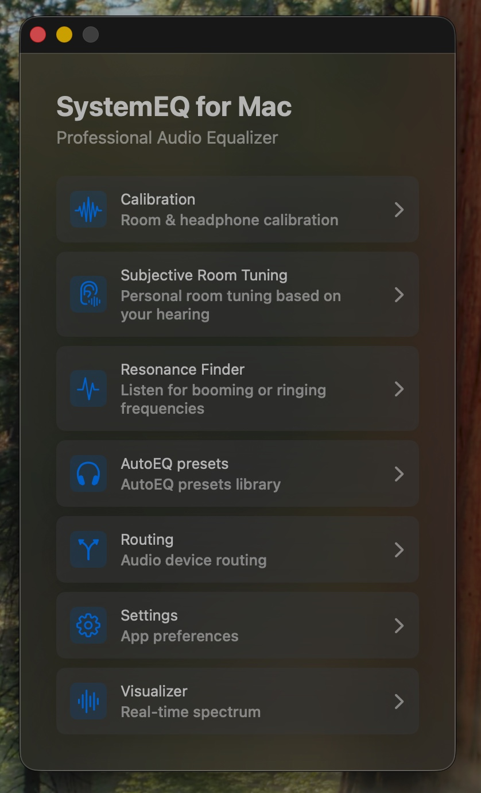
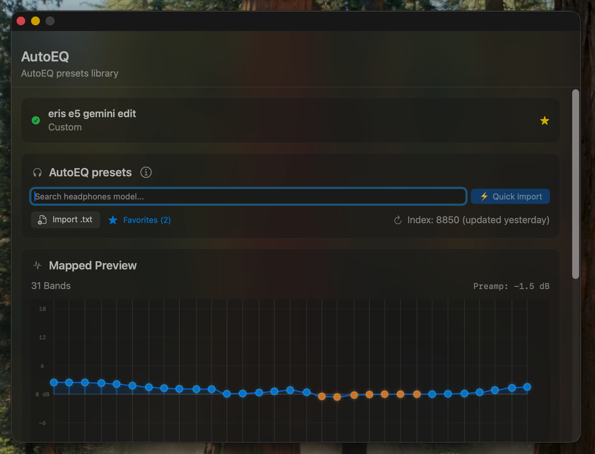
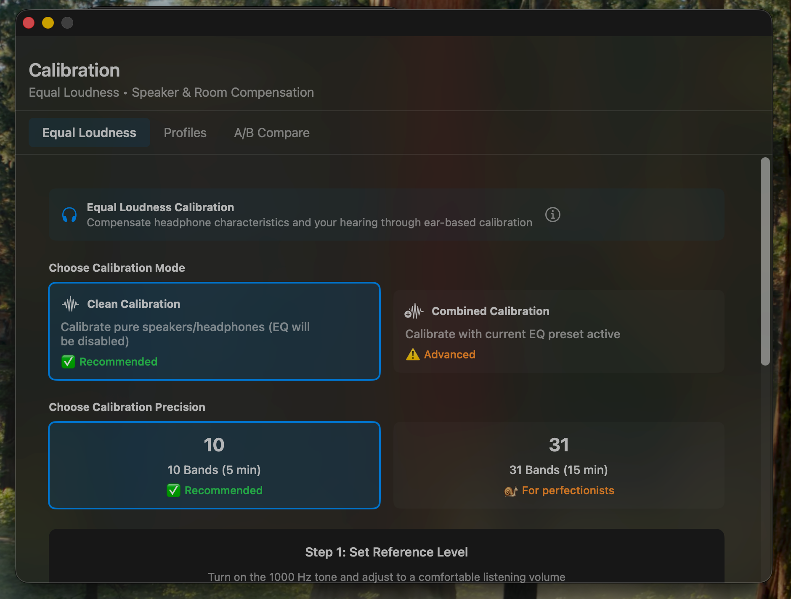
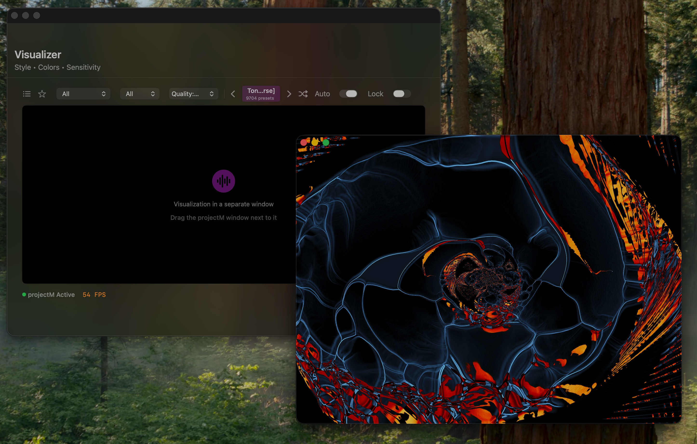
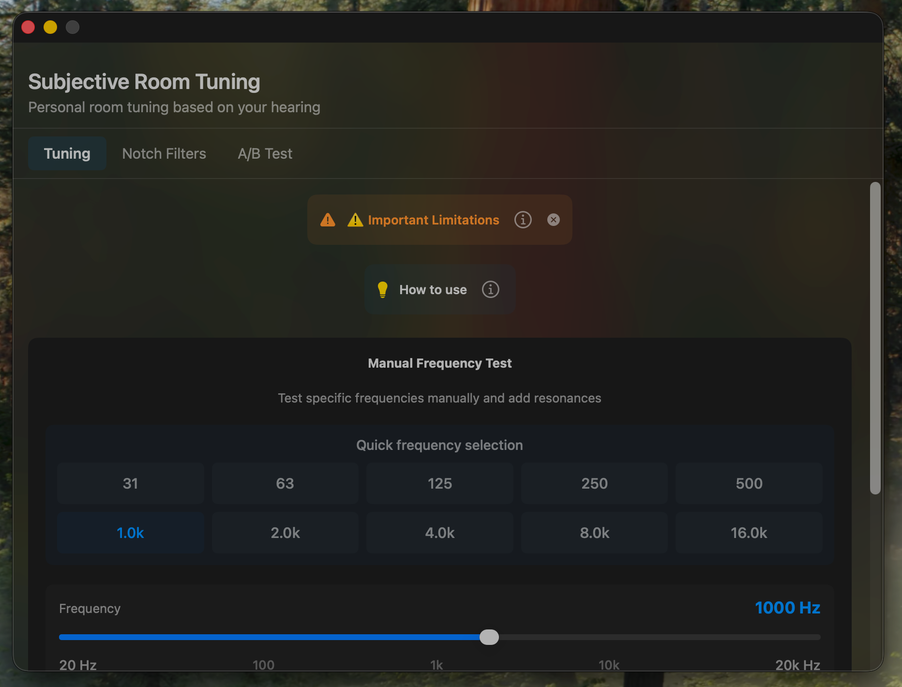
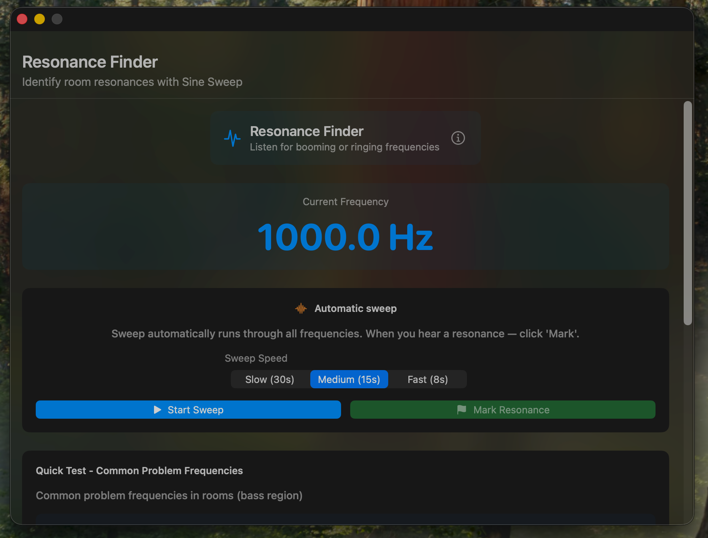
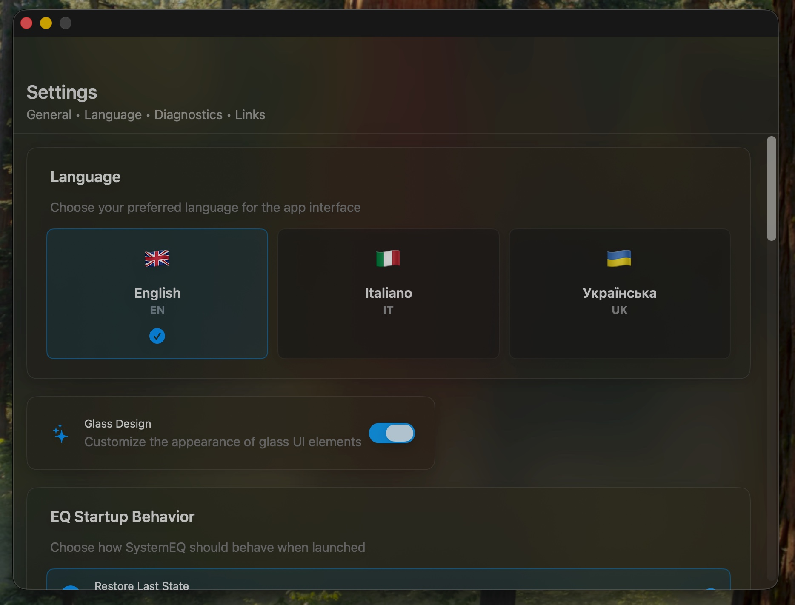

# SystemEQ for Mac

**Free, open-source system-wide parametric equalizer for macOS 13+**

Tune every sound on your Mac — Spotify, YouTube, Apple Music, anything.
10/31-band parametric EQ with an 8,665-headphone AutoEQ database, hearing
calibration, room-tuning tools, and a real-time visualizer. No subscriptions,
no telemetry.

[](https://www.apple.com/macos/)
[](https://swift.org)
[](LICENSE)
[](https://github.com/denzam/SystemEQ-for-Mac/releases/latest)
[](https://denzam.github.io/SystemEQ-for-Mac/)
[](https://github.com/denzam/SystemEQ-for-Mac/releases)

> 🇬🇧 English | 🇺🇦 [Українська](README.ua.md) | 🇮🇹 [Italiano](README.it.md)
>
> **[Jump to installation](#installation)**



## 📸 Screenshots

| Main Menu | AutoEQ Database | Calibration | Visualizer |
| :---: | :---: | :---: | :---: |
| [](Docs/screenshots/01-main.jpeg) | [](Docs/screenshots/07-autoeq-library.png) | [](Docs/screenshots/02-calibration-mode.png) | [](Docs/screenshots/15-visualizer-active.jpeg) |

| Subjective Room Tuning | Resonance Finder | Device-Aware Presets |
| :---: | :---: | :---: |
| [](Docs/screenshots/04-room-tuning.png) | [](Docs/screenshots/05-resonance-sweep.png) | [](Docs/screenshots/10-settings-language.jpeg) |

## ✨ Features

### Core Features

- **10/31-band Parametric EQ** — Professional-grade audio processing with biquad filters
- **AutoEQ Database** — 8,665 headphone models, 8,850 presets (SQLite, 18 MiB)
- **Real-time Visualization** — Spectrum, Waveform, Particles, Psychedelic
- **Calibration Module** — Hearing test + custom profiles + A/B comparison
- **Subjective Room Tuning** — Tune your room response by ear
- **Resonance Finder** — Sine sweep to identify boomy or ringing frequencies
- **Native System Audio Capture** — Process Tap on macOS 14.4+; BlackHole remains an automatic fallback
- **Preset Management** — Save, load, and organize your EQ settings
- **Auto-Switch Preset per Output** — Optionally re-apply the saved preset when you change physical output devices
- **Launch at Login** — Optional macOS login item
- **Menu Bar Mode** — Optionally hide the Dock icon while keeping the menu bar control
- **Multi-language** — English, Italian, Ukrainian

### Audio Engine

- **Audio backends** — Native Process Tap and BlackHole (AUHAL). September 2026 Scarlett loopback tests at 48 kHz measured about 11 ms Native and 25 ms BlackHole in different configurations; these are historical observations, not guarantees for the current build. [Measurement context](Docs/PerfBudget.md#physical-loopback-latency-2026-09-25).
- **vDSP Biquad Filters** — Batched filtering uses Apple Accelerate vDSP.
- **Peak Meters** — Real-time audio level monitoring
- **Clipping Protection** — Automatic gain reduction and preamp control
- **Keyboard Volume** — Uses macOS volume control when the selected device supports it; SystemEQ does not intercept media keys

### AutoEQ Integration

- **SQLite Database** — Local offline search uses SQLite FTS5.
- **Offline SQLite + Network Fallback** — Instant local database search with GitHub fallback
- **ParametricEQ & GraphicEQ** — Full format support

## 🚀 Quick Start

### Requirements

- macOS 13.0 (Ventura) or later
- Apple Silicon or Intel Mac
- [BlackHole 2ch](https://github.com/ExistentialAudio/BlackHole) (required on macOS 13–14.3; optional fallback or manual backend on macOS 14.4+)
- 4GB RAM (8GB recommended)

### Installation

1. Check your macOS version under ** → About This Mac**. SystemEQ requires **macOS 13 Ventura or later** and supports Apple Silicon and Intel Macs.
2. Open the [latest GitHub release](https://github.com/denzam/SystemEQ-for-Mac/releases/latest). Under **Assets**, choose the file named **SystemEQ-vX.Y.Z.dmg**, using the version number shown in that release.
3. Open the DMG, drag **SystemEQ for Mac** to **Applications**, then launch it from there.

#### Audio setup

**macOS 13–14.3**

1. Install [BlackHole 2ch](https://existential.audio/downloads/BlackHole2ch-0.7.1.pkg). Restart your Mac only if the installer asks; otherwise quit and reopen SystemEQ after installation.
2. In SystemEQ, open **Audio Routing → Audio Engine** and select **BlackHole**.
3. Select your headphones or speakers as the output in SystemEQ.
4. On your Mac, open ** → System Settings → Sound → Output** and select **BlackHole 2ch**.
5. Click **Enable EQ** and grant microphone access if macOS asks.

**macOS 14.4 or later**

1. In SystemEQ, open **Audio Routing → Audio Engine** and leave it set to **Automatic**.
2. Select your headphones or speakers as the output in both SystemEQ and macOS.
3. Click **Enable EQ** and allow System Audio Recording if macOS asks.

If SystemEQ asks you to use BlackHole, follow the macOS 13–14.3 steps above.

In the **AutoEQ** tab, search for your headphone model and import a preset with **⚡ Quick Import**, or adjust the bands in **Equalizer**.

#### Other installation options

You can also download the **ZIP** from the same release page, unzip it, and move the app to **Applications**. Since v1.4.6, official apps and DMGs are Developer ID signed and Apple notarized. For releases through v1.4.4, follow the installation notes on the relevant release.

**Homebrew** is another option if you already use it.

```bash
brew trust denzam/systemeq
brew install --cask denzam/systemeq/systemeq
```

Homebrew 6.0 requires `brew trust` once per Mac for this tap. On Homebrew 5 and older, skip that command.

To **build from source**, open the project in Xcode and press **⌘R**.

```bash
git clone https://github.com/denzam/SystemEQ-for-Mac.git
cd SystemEQ-for-Mac
open "SystemEQ for Mac.xcodeproj"
```

### Updating

Starting with v1.4.6, Settings → **App Updates** → **Check for App Updates**
opens the update window. When a compatible newer release is available, you can
choose to download it, install it, and restart SystemEQ from that window.
The updater verifies signed update information and packages before installation;
automatic checks are off by default. You can enable daily background checks in
Settings while SystemEQ is running, including when it launches at login. Downloads
and installation always start when you choose. EQ settings and profiles remain local.
Update checks contact GitHub and include the app and updater version, without
sending your audio, EQ settings, or a system profile.

Versions without the in-app installer need one manual update: quit SystemEQ,
download the new package, and replace the app in `/Applications`. If installed
with Homebrew, use `brew upgrade --cask systemeq` instead.

## 🛠️ Architecture

```text
macOS 14.4+: System Audio → Process Tap → vDSP Biquad EQ → Physical Output

Fallback:     System Audio → BlackHole 2ch → vDSP Biquad EQ → Physical Output
```

**No Multi-Output Device is needed.** Automatic routing uses the native macOS engine when available; BlackHole is retained for compatibility and fallback.

### Technical Details

- **CoreAudioEngine**: Low-level AUHAL dual I/O, lock-free ring buffer
- **BiquadFilterVDSP**: Batched filtering uses Apple Accelerate vDSP.
- **SPSCRingBuffer**: Lock-free SPSC buffer with C11 atomics
- **EQDatabase**: SQLite, 18 MiB, 8,665 headphone models

## 📁 Project Structure

```text
SystemEQ for Mac/
├── Audio/              # Core Audio processing
│   ├── CoreAudioEngine.swift
│   ├── AudioRouter.swift
│   ├── BiquadFilterVDSP.swift
│   ├── CalibrationEngine.swift
│   └── SPSCRingBuffer.swift
├── Data/               # Data models and database
│   ├── EQDatabase.swift
│   ├── AutoEQModels.swift
│   └── PresetPersistence.swift
├── Features/           # UI views
│   ├── EqualizerView.swift
│   ├── AutoEQView.swift
│   ├── CalibrationView.swift
│   ├── VisualizerView.swift
│   └── RoutingView.swift
├── DesignSystem/       # Design tokens and components
├── Resources/          # Assets and database
│   └── EQDatabase.db
└── Docs/               # Documentation
```

## 🎯 Usage

### Equalizer

- Adjust frequency bands with sliders
- Switch between 10-band and 31-band modes
- Save custom presets for quick recall
- Apply auto-preamp to prevent clipping

### AutoEQ Presets

1. Search for your headphone model (8,665 available)
2. Choose a preset (oratory1990, Crinacle, etc.)
3. Click "⚡ Quick Import"
4. Adjust bass boost if needed

### Calibration

1. Compare test frequencies against the fixed 1000 Hz reference
2. Adjust volume per frequency to match reference
3. Save the profile, open Profiles, and activate it
4. Use A/B comparison to test profiles

Profiles store 31 frequency adjustments. The active EQ mode determines which
frequencies are applied: 10-band mode uses matching frequencies, while 31-band
mode applies all 31 adjustments. Choose 31-band mode to use the full profile.

### Visualizer

- Choose from 4 styles: Spectrum, Waveform, Particles, Psychedelic
- Adjust intensity (0–100%)
- Real-time FFT at 60 FPS

### Room Tuning and Resonance Finder

- Use **Subjective Room Tuning** to tune your room response by ear
- Use **Resonance Finder** to sweep for boomy or ringing frequencies, then create a corrective notch filter

### Output-Specific Presets

In **Settings**, enable **Auto-Switch Preset per Output**. SystemEQ remembers
the preset applied on each physical output and re-applies it when you switch
outputs. You can also enable **Launch at Login** there.

## 🎚️ DAW Compatibility (Reaper, Logic, Ableton, etc.)

SystemEQ processes **system-wide audio output**. DAWs typically bypass the system output and talk directly to your audio interface — so EQ is **not applied** by default.

| Scenario | EQ applied? |
| --- | --- |
| Spotify, YouTube, Apple Music | ✅ Yes |
| DAW → System Output (manual config) | ✅ Yes |
| DAW → Audio Interface directly (typical) | ❌ No |
| DAW monitoring through Scarlett/Focusrite | ❌ No |

### How to use SystemEQ with your DAW

1. In your DAW, set **output device to BlackHole 2ch**
2. SystemEQ applies EQ and forwards audio to your physical output
3. To return to direct monitoring, set DAW output back to your interface

**Reaper:** Options → Preferences → Audio → Device → BlackHole 2ch

**Logic:** Preferences → Audio → Output Device → BlackHole 2ch

**Ableton:** Preferences → Audio → Output Device → BlackHole 2ch

> BlackHole routing adds buffering and may increase latency; the amount depends on the device and configuration.

## 📊 Project Status

SystemEQ ships its core EQ, routing, calibration, AutoEQ, output-specific preset, and visualizer features and is actively maintained.

## 🩺 Troubleshooting

### `Error: Refusing to load cask ... from untrusted tap`

Homebrew 6.0 will not load a third-party tap until you mark it as trusted, and a
tap owner cannot grant that for you. Run this once per Mac, then install or
upgrade as usual:

```bash
brew trust denzam/systemeq
brew upgrade --cask systemeq   # or: brew install --cask denzam/systemeq/systemeq
```

On Homebrew 5 and older the `trust` command does not exist — skip it.

### The app asks for microphone access again after an update

A first audio permission request is required even for a signed, notarized app.
Ad-hoc builds or a change of signing identity can cause another request; compatible
Developer ID signatures allow macOS to recognize updates as the same app.
See [Apple’s code identity explanation](https://developer.apple.com/documentation/technotes/tn3127-inside-code-signing-requirements).

### macOS says the app "cannot be opened"

Check the signing and installation notes for the version you downloaded.
Releases through v1.4.4 and local ad-hoc builds use a different signing policy
from the v1.4.6 Developer ID release workflow. For a signed, notarized package,
download it again from the official release page and report the exact macOS
message and app version if it is still blocked.

### No sound after setup

On macOS 14.4+, first choose **Automatic** in Settings → Audio Backend and enable EQ again. The system output should stay on your physical device. If Automatic falls back or cannot start, install BlackHole and follow the BlackHole setup below.

In **Settings → Audio Backend**, select **BlackHole**, then select your speakers
or headphones as output in **Routing**. Set **BlackHole 2ch** as the macOS System Output, click **Enable EQ**,
and keep SystemEQ running.

### Sound is quieter after switching to BlackHole

macOS stores a separate volume level for each output device. After switching
to BlackHole, raise the system volume with the keyboard volume keys or in
macOS Sound settings.

## ⚠️ Security Notice

- This app is **not sandboxed** (incompatible with CoreAudio/AUHAL virtual audio devices)
- **No telemetry, analytics, or data collection** — all data stays on your Mac
- Only install from official [GitHub Releases](https://github.com/denzam/SystemEQ-for-Mac/releases)
- Official releases from v1.4.6 are Developer ID signed and Apple-notarized; distribution checks validate signatures and stapled tickets before publication

### Security audits

The codebase is audited periodically with automated security scanning. Findings
and their resolution are tracked in [SECURITY.md](SECURITY.md); fixes ship in the
next release and are listed in [CHANGELOG.md](CHANGELOG.md).

Found something? See [SECURITY.md](SECURITY.md) for how to report it.

## 🤝 Contributing

1. Fork the project
2. Enable the pre-commit hook once per clone:
   ```bash
   git config core.hooksPath .githooks
   ```
   It formats staged Swift files and runs the same SwiftFormat and SwiftLint
   gates as CI, so a push does not fail on something catchable locally.
3. Create your feature branch (`git checkout -b feature/AmazingFeature`)
4. Commit your changes (`git commit -m 'Add AmazingFeature'`)
5. Push to the branch (`git push origin feature/AmazingFeature`)
6. Open a Pull Request

## 📄 License

**GNU General Public License v3.0** — see [LICENSE](LICENSE).

SystemEQ is free software. You may use, modify, and redistribute it, but
any redistributed version (including forks and derivative works) must
also be released under GPLv3 with full source code available. Closed-source
forks are not permitted; commercial distribution remains subject to GPLv3's
source-code and license obligations.

Third-party components and their licenses are listed in
[THIRDPARTY.md](THIRDPARTY.md).

## 🙏 Credits

- [AutoEQ](https://github.com/jaakkopasanen/AutoEq) by Jaakko Pasanen — EQ preset database
- [BlackHole](https://github.com/ExistentialAudio/BlackHole) by Existential Audio — Virtual audio driver
- [oratory1990](https://www.reddit.com/r/oratory1990/) — Headphone measurements and research

Also thanks to **Michel**, **Renato**, **David** and **Alberto** for their support and advice along the way.

## 💖 Support Development

- 🍺 [Buy Me a Coffee](https://buymeacoffee.com/denzam)
- 💝 [GitHub Sponsors](https://github.com/sponsors/denzam)

## 📧 Contact

- **GitHub**: [@denzam](https://github.com/denzam)
- **Issues / Questions**: [GitHub Issues](https://github.com/denzam/SystemEQ-for-Mac/issues)

---

**Made with ❤️ for the audio community**
