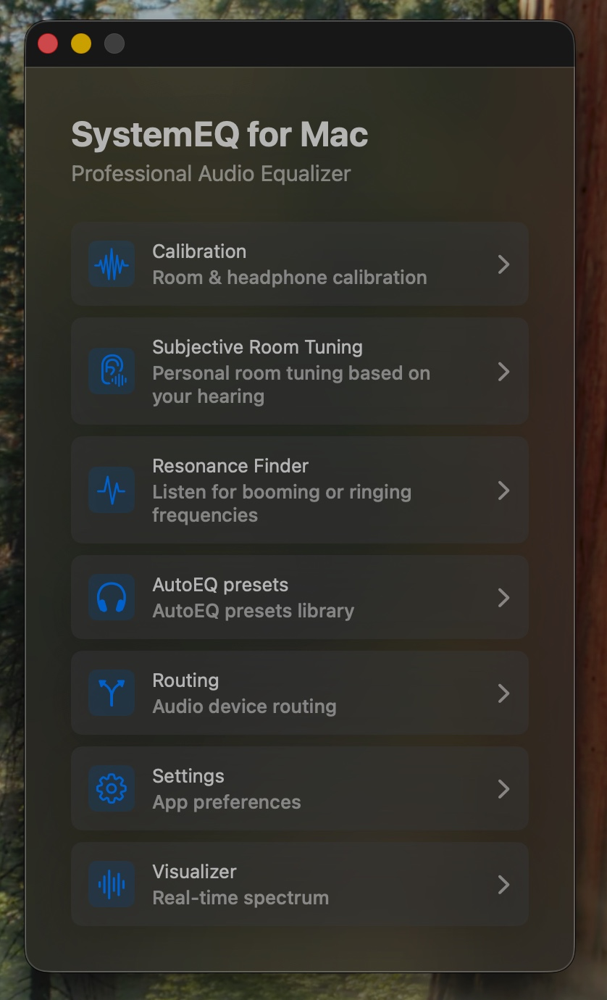
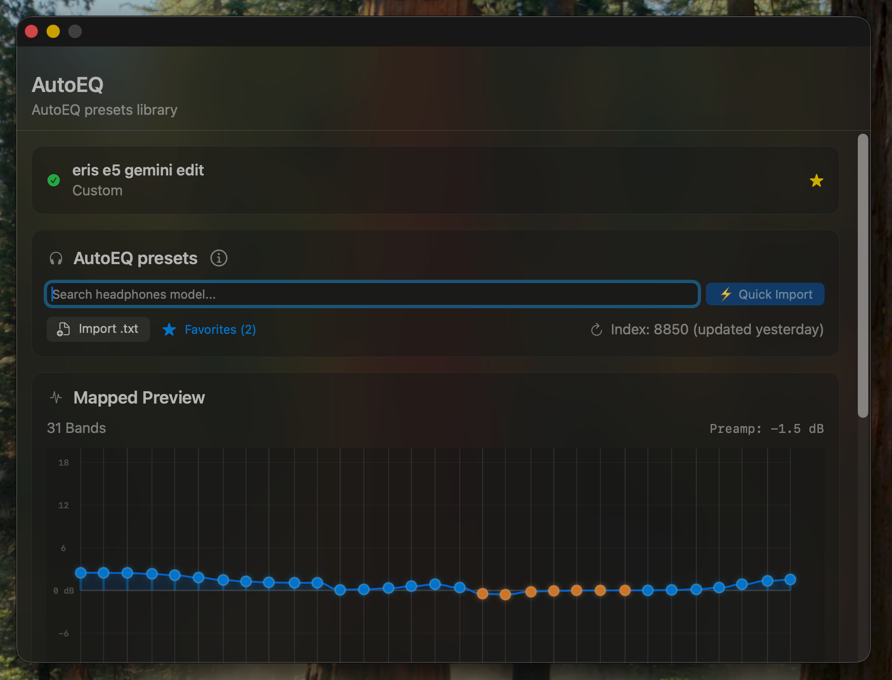
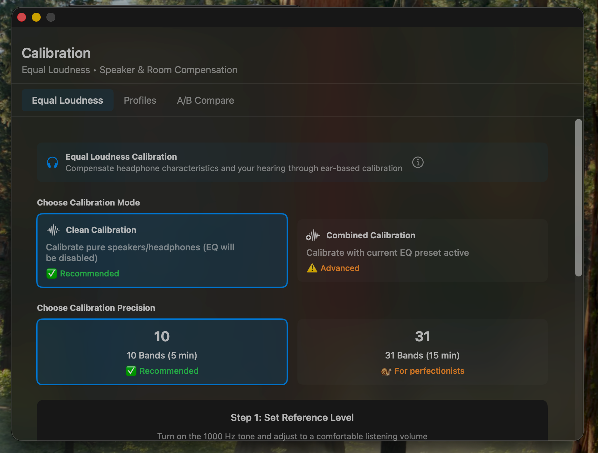
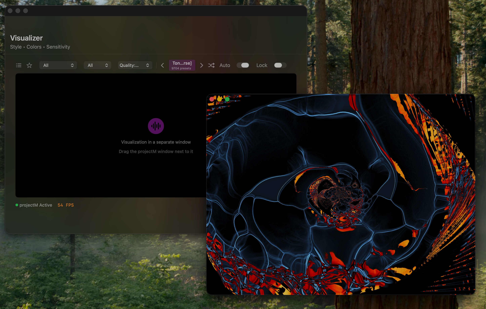
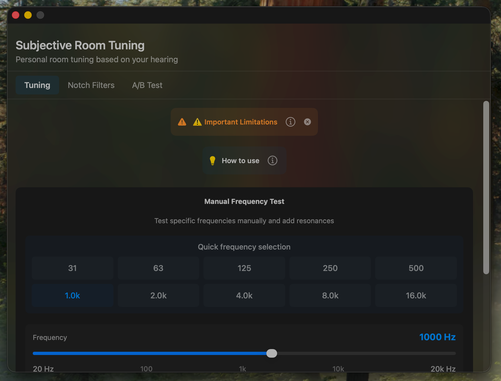
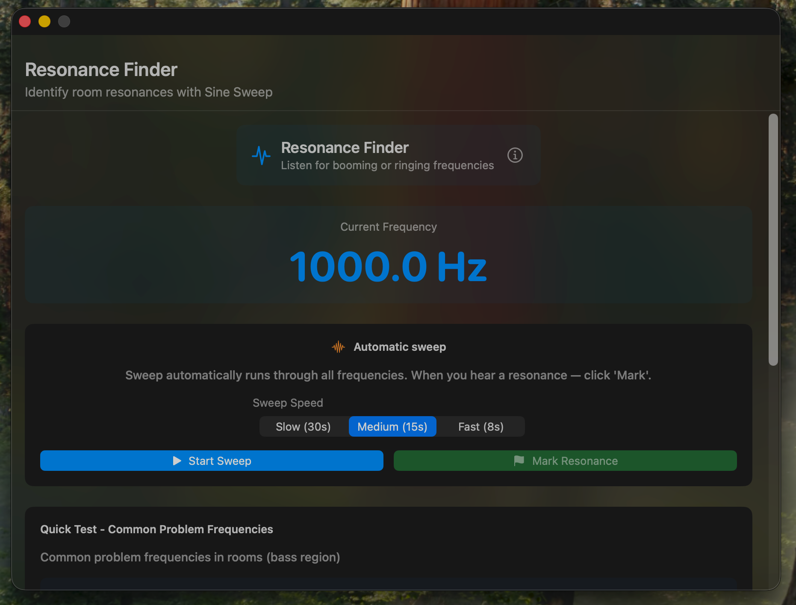
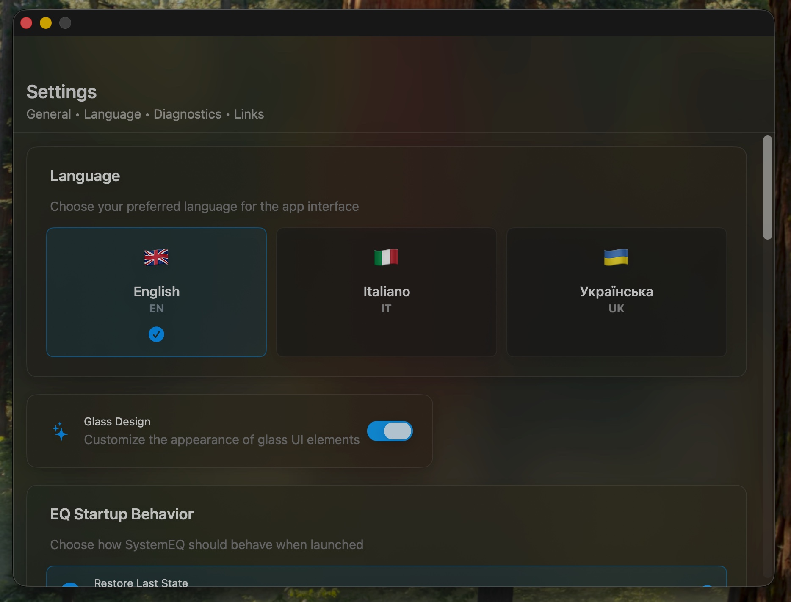

# SystemEQ for Mac

Безкоштовний open-source системний параметричний еквалайзер для macOS 13+

Налаштовуй будь-який звук на Mac — Spotify, YouTube, Apple Music та інше.
10/31-смуговий EQ, база AutoEQ для 8 665 моделей навушників, калібрація слуху,
інструменти для кімнати й візуалізатор у реальному часі. Без підписок і телеметрії.

[](https://www.apple.com/macos/)
[](https://swift.org)
[](LICENSE)
[](https://github.com/denzam/SystemEQ-for-Mac/releases/latest)
[](https://denzam.github.io/SystemEQ-for-Mac/)
[](https://github.com/denzam/SystemEQ-for-Mac/releases)

> 🇺🇦 Українська | 🇬🇧 [English](README.md) | 🇮🇹 [Italiano](README.it.md)
>
> **[Перейти до встановлення](#встановлення)**



## 📸 Скріншоти

| Головне меню | База AutoEQ | Калібрація | Візуалізатор |
| :---: | :---: | :---: | :---: |
| [](Docs/screenshots/01-main.jpeg) | [](Docs/screenshots/07-autoeq-library.png) | [](Docs/screenshots/02-calibration-mode.png) | [](Docs/screenshots/15-visualizer-active.jpeg) |

| Суб’єктивне налаштування кімнати | Пошук резонансів | Пресети для кожного виводу |
| :---: | :---: | :---: |
| [](Docs/screenshots/04-room-tuning.png) | [](Docs/screenshots/05-resonance-sweep.png) | [](Docs/screenshots/10-settings-language.jpeg) |

## ✨ Можливості

### Основні функції

- **10/31-смуговий параметричний EQ** — Професійна обробка звуку з biquad-фільтрами
- **База даних AutoEQ** — 8 665 моделей навушників, 8 850 пресетів (SQLite, 18 МіБ)
- **Візуалізація в реальному часі** — Спектр, Хвиля, Частинки, Психоделічний
- **Модуль калібрації** — Тест слуху + власні профілі + порівняння A/B
- **Суб'єктивне налаштування кімнати** — Налаштовуй звучання кімнати на слух
- **Пошук резонансів** — Синусоїдальний sweep для пошуку гудіння чи дзвону
- **Нативне захоплення системного звуку** — Process Tap на macOS 14.4+; BlackHole лишається автоматичним резервним маршрутом
- **Управління пресетами** — Зберігай, завантажуй та організовуй налаштування EQ
- **Авто-пресет для кожного виводу** — За бажанням застосовує збережений пресет після зміни фізичного виходу
- **Запускати при вході** — Необов’язковий Login Item macOS
- **Ховати іконку з Dock** — За бажанням залишає керування лише в меню-барі
- **Багатомовність** — Англійська, Італійська, Українська

### Аудіодвигун

- **Звукові рушії** — Native Process Tap і BlackHole (AUHAL). У вересневих тестах 2026 року зі Scarlett на 48 кГц отримано близько 11 мс Native і 25 мс BlackHole в різних конфігураціях; це історичні спостереження, а не гарантії для поточної збірки. [Умови вимірювань](Docs/PerfBudget.md#physical-loopback-latency-2026-09-25).
- **vDSP Biquad-фільтри** — Пакетна обробка фільтрів використовує Apple Accelerate vDSP.
- **Пік-метри** — Моніторинг рівня звуку в реальному часі
- **Захист від кліпінгу** — Автоматичне зменшення підсилення та контроль преампу
- **Підтримка медіаклавіш** — Керування гучністю з клавіатури

### Інтеграція з AutoEQ

- **SQLite-база даних** — Локальний офлайн-пошук використовує SQLite FTS5.
- **Офлайн SQLite + мережевий fallback** — Миттєвий пошук у локальній базі з резервним зверненням до GitHub
- **ParametricEQ та GraphicEQ** — Повна підтримка форматів

## 🚀 Швидкий старт

### Вимоги

- macOS 13.0 (Ventura) або новіша
- Apple Silicon або Intel Mac
- [BlackHole 2ch](https://github.com/ExistentialAudio/BlackHole) (потрібен на macOS 13–14.3; на macOS 14.4+ — необов’язковий резервний або ручний backend)
- 4 ГБ RAM (рекомендовано 8 ГБ)

### Встановлення

1. Перевір версію macOS у меню ** → Про цей Mac**. Потрібна **macOS 13 Ventura або новіша**. Підтримуються Mac з Apple Silicon та Intel.
2. Відкрий [останній реліз на GitHub](https://github.com/denzam/SystemEQ-for-Mac/releases/latest). У розділі **Assets** вибери файл **SystemEQ-vX.Y.Z.dmg**, підставивши номер версії з цього релізу.
3. Відкрий DMG, перетягни **SystemEQ for Mac** до **Програми**, а потім запусти застосунок звідти.

#### Налаштування звуку

**macOS 13–14.3**

1. Встанови [BlackHole 2ch](https://existential.audio/downloads/BlackHole2ch-0.7.1.pkg). Перезавантаж Mac, лише якщо цього попросить інсталятор; інакше після встановлення закрий і знову відкрий SystemEQ.
2. У SystemEQ відкрий **Маршрутизація аудіо → Аудіорушій** і вибери **BlackHole**.
3. Вибери свої навушники або колонки як вихід у SystemEQ.
4. На Mac відкрий ** → Системні параметри → Звук → Вихід** і вибери **BlackHole 2ch**.
5. Натисни **Увімкнути EQ** і надай доступ до мікрофона, якщо macOS попросить.

**macOS 14.4 або новіша**

1. У SystemEQ відкрий **Маршрутизація аудіо → Аудіорушій** і залиш режим **Автоматично**.
2. Вибери свої навушники або колонки як вихід у SystemEQ і macOS.
3. Натисни **Увімкнути EQ** і дозволь запис системного аудіо, якщо macOS попросить.

Якщо SystemEQ запропонує перейти на BlackHole, виконай наведені вище кроки для macOS 13–14.3.

На вкладці **AutoEQ** знайди модель навушників та імпортуй пресет через **⚡ Quick Import** або налаштуй смуги у **Equalizer**.

#### Інші способи встановлення

Можна також завантажити **ZIP** із тієї самої сторінки релізу, розпакувати його та перемістити застосунок до **Програм**. Починаючи з v1.4.6, офіційні застосунки й DMG мають підпис Developer ID і нотаризацію Apple. Для релізів до v1.4.4 включно дотримуйся інструкцій на сторінці відповідного релізу.

**Homebrew** — ще один варіант, якщо ти вже ним користуєшся.

```bash
brew trust denzam/systemeq
brew install --cask denzam/systemeq/systemeq
```

У Homebrew 6.0 команду `brew trust` потрібно виконати один раз на Mac для цього tap. У Homebrew 5 і старіших її пропусти.

Щоб **зібрати з вихідного коду**, відкрий проєкт у Xcode і натисни **⌘R**.

```bash
git clone https://github.com/denzam/SystemEQ-for-Mac.git
cd SystemEQ-for-Mac
open "SystemEQ for Mac.xcodeproj"
```

### Оновлення

Починаючи з v1.4.6, у Налаштуваннях → **Оновлення програми** натисни
**Перевірити оновлення програми**, щоб відкрити вікно оновлення. Якщо доступна
сумісна новіша версія, у цьому вікні можна вибрати завантаження, встановлення
та перезапуск SystemEQ. Перед встановленням перевіряються підписи стрічки й пакета;
автоматичні перевірки початково вимкнені. У Налаштуваннях можна ввімкнути щоденну
фонову перевірку, поки SystemEQ працює, зокрема після автозапуску при вході.
Завантаження й встановлення завжди запускаєш ти. Налаштування EQ і профілі лишаються локальними.
Запити оновлень надходять до GitHub і містять версії застосунку й оновлювача,
але не передають аудіо, налаштування EQ чи профіль системи.

Версії без вбудованого інсталятора потребують одного ручного оновлення: заверши
SystemEQ, завантаж новий пакет і заміни застосунок у `/Applications`.
Якщо встановлював через Homebrew, натомість виконай `brew upgrade --cask systemeq`.

## 🛠️ Архітектура

```text
macOS 14.4+: Системний звук → Process Tap → vDSP Biquad EQ → Фізичний вихід

Резервний:   Системний звук → BlackHole 2ch → vDSP Biquad EQ → Фізичний вихід
```

**Multi-Output Device не потрібен.** Автоматичний режим використовує нативний рушій macOS, коли він доступний; BlackHole лишається для сумісності та резервного переходу.

### Технічні деталі

- **CoreAudioEngine**: Низькорівневий AUHAL dual I/O, lock-free ring buffer
- **BiquadFilterVDSP**: Пакетна обробка фільтрів використовує Apple Accelerate vDSP.
- **SPSCRingBuffer**: Lock-free SPSC буфер з C11 атомарними операціями
- **EQDatabase**: SQLite, 18 МіБ, 8 665 моделей навушників

## 📁 Структура проєкту

```text
SystemEQ for Mac/
├── Audio/              # Обробка Core Audio
│   ├── CoreAudioEngine.swift
│   ├── AudioRouter.swift
│   ├── BiquadFilterVDSP.swift
│   ├── CalibrationEngine.swift
│   └── SPSCRingBuffer.swift
├── Data/               # Моделі даних та база
│   ├── EQDatabase.swift
│   ├── AutoEQModels.swift
│   └── PresetPersistence.swift
├── Features/           # UI-вікна
│   ├── EqualizerView.swift
│   ├── AutoEQView.swift
│   ├── CalibrationView.swift
│   ├── VisualizerView.swift
│   └── RoutingView.swift
├── DesignSystem/       # Дизайн-токени та компоненти
├── Resources/          # Ресурси та база даних
│   └── EQDatabase.db
└── Docs/               # Документація
```

## 🎯 Використання

### Еквалайзер

- Регулюй частотні смуги слайдерами
- Перемикайся між 10-смуговим і 31-смуговим режимом
- Зберігай власні пресети для швидкого виклику
- Застосовуй авто-преамп для захисту від кліпінгу

### Пресети AutoEQ

1. Знайди модель своїх навушників (доступно 8 665)
2. Обери пресет (oratory1990, Crinacle тощо)
3. Натисни "⚡ Quick Import"
4. За потреби скорегуй підсилення басів

### Калібрація

1. Запусти тест слуху (31 частота)
2. Відрегулюй гучність для кожної частоти відносно еталону
3. Збережи профіль для автоматичного застосування
4. Використовуй порівняння A/B для оцінки профілів

### Візуалізатор

- Обери один з 4 стилів: Spectrum, Waveform, Particles, Psychedelic
- Налаштуй інтенсивність (0–100%)
- FFT в реальному часі при 60 FPS

### Налаштування кімнати та пошук резонансів

- **Суб’єктивне налаштування кімнати** допомагає налаштувати звучання кімнати на слух
- **Пошук резонансів** знаходить гудіння чи дзвін, щоб потім створити коригувальний notch-фільтр

### Пресети для різних виходів

У **Налаштуваннях** увімкни **Авто-пресет для кожного виводу**.
SystemEQ запам’ятає пресет для кожного фізичного виходу й застосує його після
перемикання. Там само можна ввімкнути **Запускати при вході**.

## 🎚️ Сумісність з DAW (Reaper, Logic, Ableton та інші)

SystemEQ обробляє **системний аудіовихід**. DAW зазвичай обходять системний вихід і звертаються напряму до аудіоінтерфейсу — тому EQ **не застосовується** за замовчуванням.

| Сценарій | EQ застосовується? |
| --- | --- |
| Spotify, YouTube, Apple Music | ✅ Так |
| DAW → Системний вихід (ручне налаштування) | ✅ Так |
| DAW → Аудіоінтерфейс напряму (типово) | ❌ Ні |
| Моніторинг через Scarlett/Focusrite | ❌ Ні |

### Як використовувати SystemEQ разом з DAW

1. У DAW встанови **вихідний пристрій на BlackHole 2ch**
2. SystemEQ застосує EQ і передасть аудіо на фізичний вихід
3. Щоб повернутися до прямого моніторингу — встанови вихід DAW назад на інтерфейс

**Reaper:** Options → Preferences → Audio → Device → BlackHole 2ch

**Logic:** Preferences → Audio → Output Device → BlackHole 2ch

**Ableton:** Preferences → Audio → Output Device → BlackHole 2ch

> Маршрутизація BlackHole додає буферизацію та може збільшувати затримку; величина залежить від пристрою й конфігурації.

## 📊 Статус проєкту

SystemEQ має й активно підтримує основні можливості: EQ, маршрутизацію,
калібрацію, AutoEQ, пресети для різних виходів і візуалізатор.

## 🩺 Усунення несправностей

### `Error: Refusing to load cask ... from untrusted tap`

Homebrew 6.0 не завантажує сторонні тапи, поки ви не позначите їх довіреними, і
власник тапу зробити це за вас не може. Виконайте один раз на кожному Mac, а далі
встановлюйте чи оновлюйте як завжди:

```bash
brew trust denzam/systemeq
brew upgrade --cask systemeq   # або: brew install --cask denzam/systemeq/systemeq
```

У Homebrew 5 і старіших команди `trust` не існує — пропустіть її.

### Після оновлення застосунок знову просить доступ до мікрофона

Перший дозвіл на аудіо потрібен і підписаному, нотаризованому застосунку.
Ad-hoc збірка або зміна ідентичності підпису можуть спричинити повторний запит;
сумісні підписи Developer ID дозволяють macOS розпізнавати оновлення як той самий застосунок.
Див. [пояснення Apple](https://developer.apple.com/documentation/technotes/tn3127-inside-code-signing-requirements).

### macOS пише, що застосунок «неможливо відкрити»

Перевір примітки про підпис і встановлення завантаженої версії.
Релізи до v1.4.4 включно й локальні ad-hoc збірки мають іншу політику підпису,
ніж релізний workflow v1.4.6 із Developer ID. Якщо підписаний і нотаризований
пакет досі заблоковано, завантаж його повторно з офіційної сторінки релізу
та повідом точний текст попередження macOS і версію застосунку.

### Немає звуку після налаштування

На macOS 14.4+ спершу обери **Автоматичний** у Settings → Audio Backend і ще раз увімкни EQ. Системний вихід має лишатися фізичним пристроєм. Якщо Automatic перейшов у fallback або не запускається, встанови BlackHole і виконай інструкції нижче.

У **Settings → Audio Backend** обери **BlackHole**, а в **Routing** — навушники або колонки як вихід.
Встанови **BlackHole 2ch** системним виходом macOS, натисни **Увімкнути EQ**
і тримай SystemEQ запущеним.

### Після перемикання на BlackHole звук тихіший

macOS зберігає окрему гучність для кожного вихідного пристрою. Після
перемикання на BlackHole підніми системну гучність клавішами або в налаштуваннях звуку macOS.

## ⚠️ Безпека

- Застосунок **не sandboxed** (несумісно з CoreAudio/AUHAL віртуальними пристроями)
- **Без телеметрії, аналітики та збору даних** — всі дані залишаються на твоєму Mac
- Встановлюй лише з офіційних [GitHub Releases](https://github.com/denzam/SystemEQ-for-Mac/releases)
- Офіційні релізи від v1.4.6 мають підпис Developer ID та нотаризацію Apple; перед публікацією перевіряються підписи й прикріплені квитки нотаризації

## 🤝 Внесок у проєкт

1. Зроби fork проєкту
2. Створи гілку для функції (`git checkout -b feature/AmazingFeature`)
3. Збережи зміни (`git commit -m 'Add AmazingFeature'`)
4. Надішли гілку (`git push origin feature/AmazingFeature`)
5. Відкрий Pull Request

## 📄 Ліцензія

**GNU General Public License v3.0** — див. [LICENSE](LICENSE).

SystemEQ — вільне програмне забезпечення. Ти можеш використовувати,
змінювати та розповсюджувати його, але **будь-який форк чи похідна
робота** мусить бути випущена під GPLv3 з відкритим вихідним кодом.
Закриті форки заборонені; комерційне поширення можливе лише з дотриманням
умов GPLv3 щодо вихідного коду та ліцензії.

Сторонні компоненти та їхні ліцензії — у [THIRDPARTY.md](THIRDPARTY.md).

## 🙏 Подяки

- [AutoEQ](https://github.com/jaakkopasanen/AutoEq) від Jaakko Pasanen — база даних пресетів EQ
- [BlackHole](https://github.com/ExistentialAudio/BlackHole) від Existential Audio — віртуальний аудіодрайвер
- [oratory1990](https://www.reddit.com/r/oratory1990/) — вимірювання навушників та дослідження

Окрема подяка **Michel**, **Renato**, **David** та **Alberto** за підтримку та поради впродовж розробки.

## 💖 Підтримати розробку

- 🍺 [Buy Me a Coffee](https://buymeacoffee.com/denzam)
- 💝 [GitHub Sponsors](https://github.com/sponsors/denzam)

## 📧 Контакти

- **GitHub**: [@denzam](https://github.com/denzam)
- **Issues / Питання**: [GitHub Issues](https://github.com/denzam/SystemEQ-for-Mac/issues)

---

Зроблено з ❤️ для аудіоспільноти
